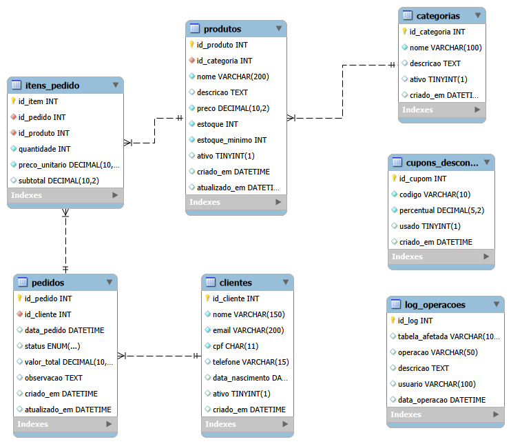
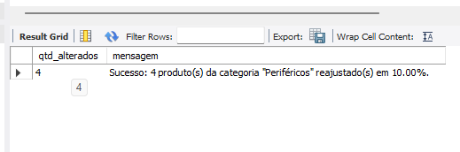
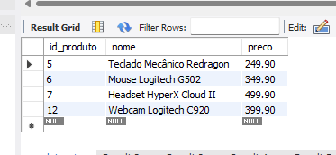
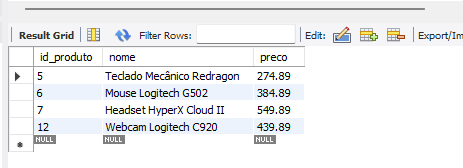
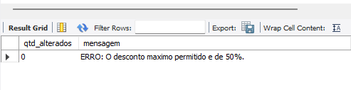
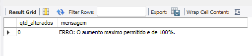
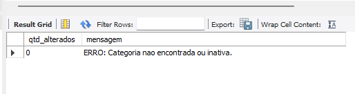
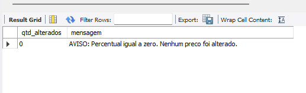
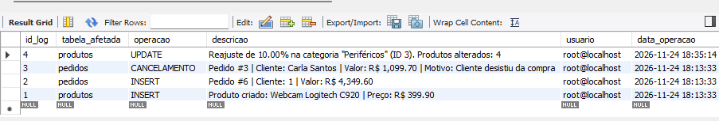

# Loja Tech — Banco de Dados


Projeto prático de banco de dados relacional para uma loja de tecnologia. O repositório apresenta a modelagem das entidades, dados de exemplo, procedures, transações, validações de regras de negócio e registros de auditoria.

---

## Conteúdo

- [Modelo do banco](#modelo-do-banco)
- [Estrutura das tabelas](#estrutura-das-tabelas)
- [Como executar](#como-executar)
- [Stored Procedure desenvolvida](#stored-procedure-desenvolvida)
- [Testes realizados](#testes-realizados)
- [Evidências de auditoria](#evidências-de-auditoria)
- [Organização do repositório](#organização-do-repositório)

---

## Modelo do banco

O banco `loja_tech` organiza produtos por categoria e associa clientes, pedidos e itens de pedido por meio de chaves estrangeiras.



### Resumo dos relacionamentos

| Relacionamento | Cardinalidade |
| :--- | :--- |
| Categoria → Produtos | Uma categoria possui vários produtos |
| Cliente → Pedidos | Um cliente pode realizar vários pedidos |
| Pedido → Itens do pedido | Um pedido pode conter vários itens |
| Produto → Itens do pedido | Um produto pode aparecer em vários pedidos |

---

## Estrutura das tabelas

| Tabela | Finalidade |
| :--- | :--- |
| `categorias` | Categorias dos produtos |
| `produtos` | Catálogo, preço, estoque e situação ativa |
| `clientes` | Dados cadastrais dos clientes |
| `pedidos` | Pedidos, status e valor total |
| `itens_pedido` | Produtos e quantidades de cada pedido |
| `cupons_desconto` | Cupons disponíveis e respectivos percentuais |
| `log_operacoes` | Histórico de alterações e operações executadas |

---

## Como executar

### Pré-requisitos

- MySQL Server
- MySQL Workbench

### Instalação

1. Abra o MySQL Workbench e conecte-se ao servidor.
2. Execute o arquivo principal:

```sql
SOURCE Database/banco-de-dados-loja-tech.sql;
```

3. Para criar e testar a procedure, execute:

```sql
SOURCE Database/banco-de-dados-loja-tech-exercicios.sql;
```

Os arquivos separados na pasta `Database` também podem ser utilizados para restaurar partes específicas do banco.

---

## Stored Procedure desenvolvida

### `atualizar_preco_categoria`

Atualiza em lote o preço dos produtos ativos de uma categoria, aplicando um percentual de aumento ou desconto.

```sql
CALL atualizar_preco_categoria(
    3,
    10.00,
    @quantidade,
    @mensagem
);

SELECT @quantidade AS produtos_alterados,
       @mensagem   AS resultado;
```

### Parâmetros

| Parâmetro | Tipo | Direção | Descrição |
| :--- | :--- | :--- | :--- |
| `p_id_categoria` | `INT` | `IN` | ID da categoria |
| `p_percentual` | `DECIMAL(5,2)` | `IN` | Percentual de reajuste |
| `p_qtd_alterados` | `INT` | `OUT` | Quantidade de produtos atualizados |
| `p_mensagem` | `VARCHAR(255)` | `OUT` | Resultado da operação |

### Regras implementadas

- A categoria precisa existir e estar ativa.
- Descontos podem chegar a **50%**.
- Aumentos podem chegar a **100%**.
- Percentual igual a zero não altera preços.
- Somente produtos ativos da categoria são atualizados.
- Os preços são arredondados com duas casas decimais.
- A operação é registrada na tabela `log_operacoes`.
- Falhas inesperadas utilizam transação e cancelam as alterações.

---

## Testes realizados

Os testes validam o caminho positivo e os principais erros de entrada.

### Reajuste válido



### Produto atualizado

Os produtos da categoria selecionada recebem o novo valor após o reajuste.





### Desconto acima do limite

Percentual de `-60%` é rejeitado porque excede o desconto máximo.



### Aumento acima do limite

Percentual de `150%` é rejeitado porque excede o aumento máximo.



### Categoria inexistente

Uma categoria não encontrada ou inativa retorna uma mensagem de erro.



### Percentual zero

Quando o percentual é zero, nenhum preço é alterado.



---

## Evidências de auditoria

Cada operação registrada apresenta a tabela afetada, o tipo de operação, uma descrição e o usuário que executou a ação.



Exemplo de consulta para visualizar os últimos registros:

```sql
SELECT *
FROM log_operacoes
ORDER BY id_log DESC;
```

---

## Organização do repositório

```text
loja_tech_db/
├── Database/
│   ├── banco-de-dados-loja-tech.sql
│   ├── banco-de-dados-loja-tech-exercicios.sql
│   └── arquivos SQL individuais das tabelas
├── image/
│   ├── MER.png
│   └── evidências dos testes
└── README.md
```
